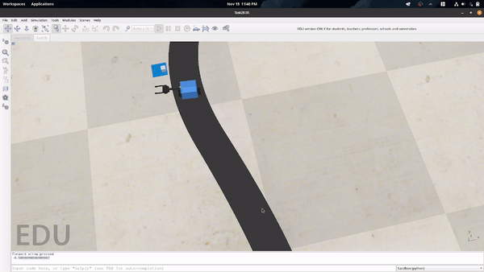
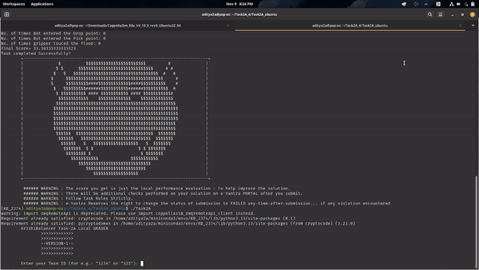
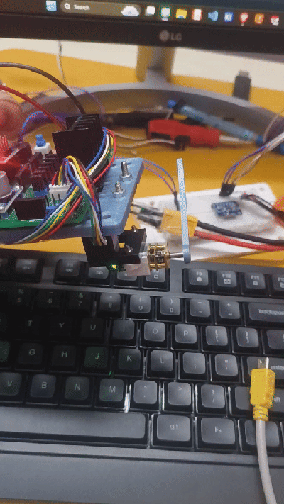
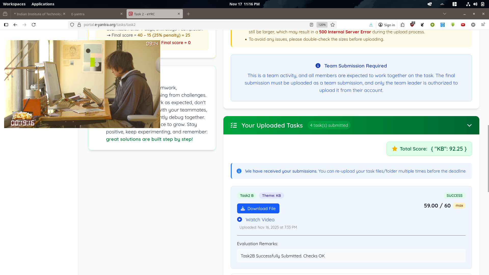
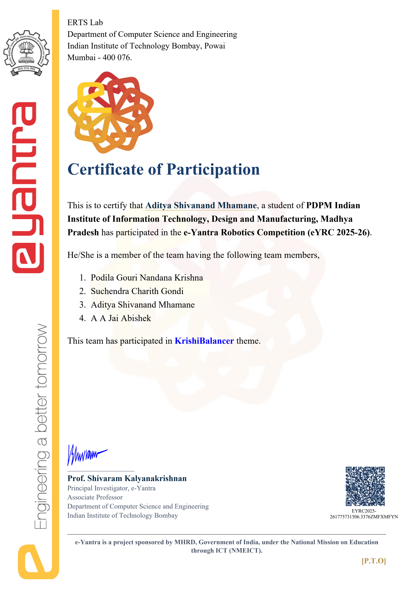

# KrishiBalancer (KB) — e-Yantra Robotics Competition 2025–26

[-orange?style=flat-square)](https://portal.e-yantra.org)

[-brightgreen?style=flat-square)](https://portal.e-yantra.org)

> An autonomous, self-balancing mobile robot with an onboard manipulator capable of dynamic upright stability, tight path navigation, and pick-and-place delivery under external disturbances.

---

##  Summary

* **Project:** Two-wheeled inverted pendulum self-balancing robot with pick-and-place manipulator.
* **Organizer:** ERTS Lab, CSE Department, **IIT Bombay** (eYRC 2025–26).
* **Role:** **Lead Control & Simulation Engineer** | **Lead CAD & Mechanical Design**.
* **Key Outcome:** Cleared **Stage 1**, securing qualification for the physical hardware stage and receiving the hardware development kit from IIT Bombay.

---

##  Key Highlights & Engineering Contributions

### 1. Control Systems & Simulation (Lead)
- **Advanced Control Theory:** Modeled the two-wheeled robot as an **Inverted Pendulum System** and implemented **LQR (Linear Quadratic Regulator)** and **PID controllers** (non linearized pid).
- **Dynamic Balancing & Trajectory Tracking:** Achieved stable upright balancing while maneuvering along sharp curves, stopping at designated checkpoints, and compensating for center-of-gravity shifts during box pick-and-place.
- **Fast-Track Self-Directed Learning:** Self-learned State-Space modeling, Modern Control Theory, LQR, and PID during **Semester 3** (prior to university control coursework in Sem 4).
- **Simulation Rig:** Mastered **CoppeliaSim** with Python remote API integration for realistic physics-based simulation.
- **Hardware Motor Control:** Engineered closed-loop position PID control for high-torque N20 geared DC motors for the physical robot.

### 2. CAD Design & 3D Printing (Lead)
- **Full Assembly in Autodesk Fusion 360:** Designed custom and novel chassis and plates, motor brackets, PCB mounts, and a  manipulator clamp.

- **Design for Additive Manufacturing (DFAM):** Optimized design for costs, weight.

---

## 🎬 Demonstrations & Media

### 1. Inverted Pendulum LQR Control (Stage 1 – Task 2)
Navigating tight trajectories with robust LQR balancing and waypoint tracking.

* 📺 **Task 2B YouTube Submission:** [Watch on YouTube](https://youtu.be/mJipfV2WkCA)
* 📁 **Full Task 2 Drive Video:** [Google Drive Link](https://drive.google.com/file/d/1EXEojUotGHF_DAtiIRImlHnBNtPw4GWU/view?usp=sharing)

---

### 2. Dynamic Balancing & Manipulator Pick-and-Place
Balancing at a stationary coordinate, picking up fertilizer crates, and traversing forward while maintaining stability under load.

* 📁 **Complete Balance & Pick Video:** [Google Drive Link](https://drive.google.com/file/d/1VnmkC_7Go056u7VrpWeRh6ws96bAUcQm/view?usp=sharing)

📂 **All Simulation Recordings and other images:** [Complete Google Drive Folder](https://drive.google.com/drive/folders/1hnwOU2GodLctW0amU1T8utnlZNkdbAht?usp=sharing)

---

### 3. Some Clips from Second Stage (Hardware Stage)
Tuning and testing closed-loop PID position control on N20 encoder motors for the physical prototype.

---

##  CAD Modeling & Hardware Prototype

| CAD Assembly (Fusion 360) | Physical Bot Assembly |
| :---: | :---: |
|  |  |
| *Multi-tier modular chassis with manipulator* | *Assembled self-balancing robot with gripper* |

| Hardware Kit Received (from IIT Bombay) | Stage 1 Portal Score  |
| :---: | :---: |
|  |  |
| *Stage 1 qualification kit dispatched to team* | *Task 2B score: 59.00 / 60 max (Total: 92.25)* |

---

##  Certificate & Verification

Issued by **ERTS Lab, Department of Computer Science & Engineering, IIT Bombay**.

Received Certificate of Participation (Level 3) out of four levels. After successfully completing stage 1 of competition 

* 📄 **Certificate PDF:** [`certificate/DOC-20260428-WA0001..pdf`](certificate/DOC-20260428-WA0001..pdf)
* 🔗 **Online Verification:** [Verify at e-Yantra Portal](http://certificate.e-yantra.org/validate/EYRC2025-261775731506.3376ZMFXMFYN)

---

## Tech Stack & Tools

* **Control Theory & Modeling:** State-Space Representation, LQR, PID Control, Inverted Pendulum Dynamics, Filters.
* **Simulation & Programming:** Python, CoppeliaSim, NumPy, Matplotlib.
* **Mechanical & CAD:** Autodesk Fusion 360, DFM / 3D Printing, Prototyping.
* **Embedded Hardware:** N20 Encoder Motors, Motor Drivers, Microcontrollers, Sensor Fusion, IMUs, etc.
